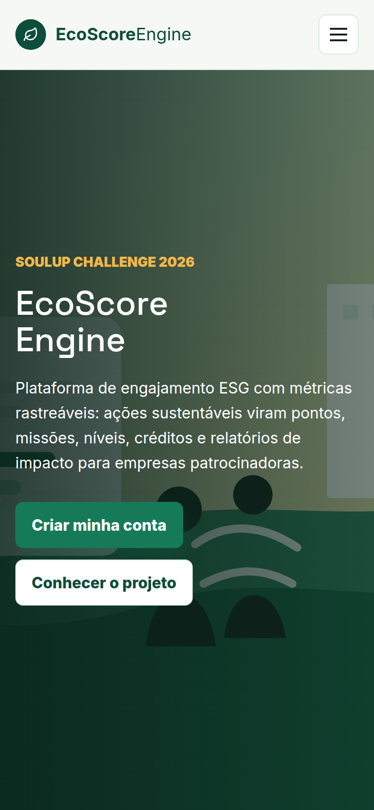
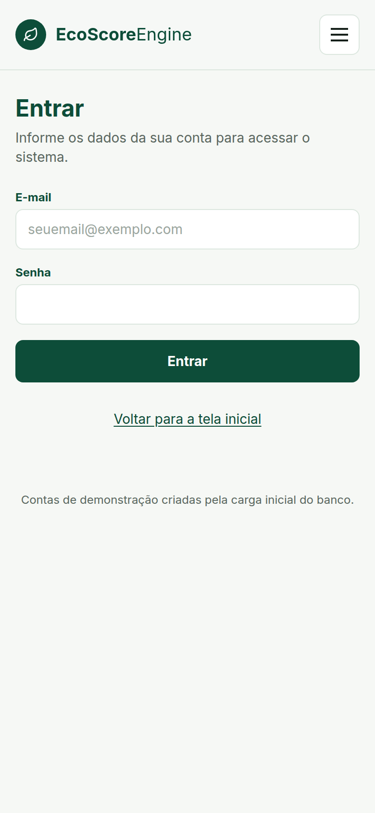
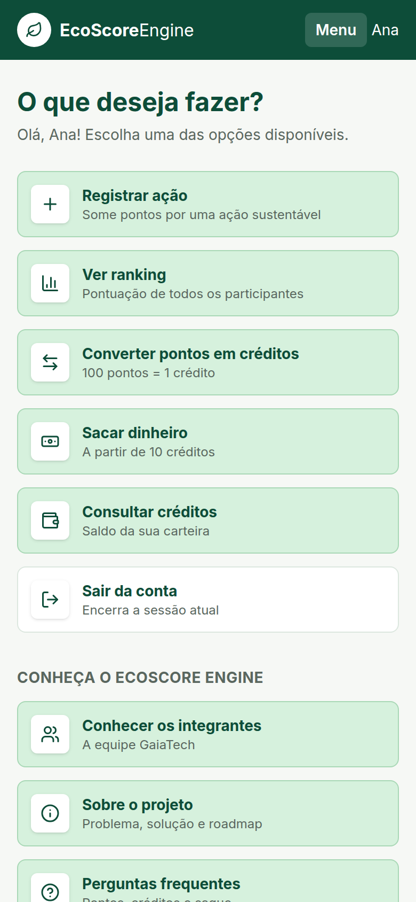
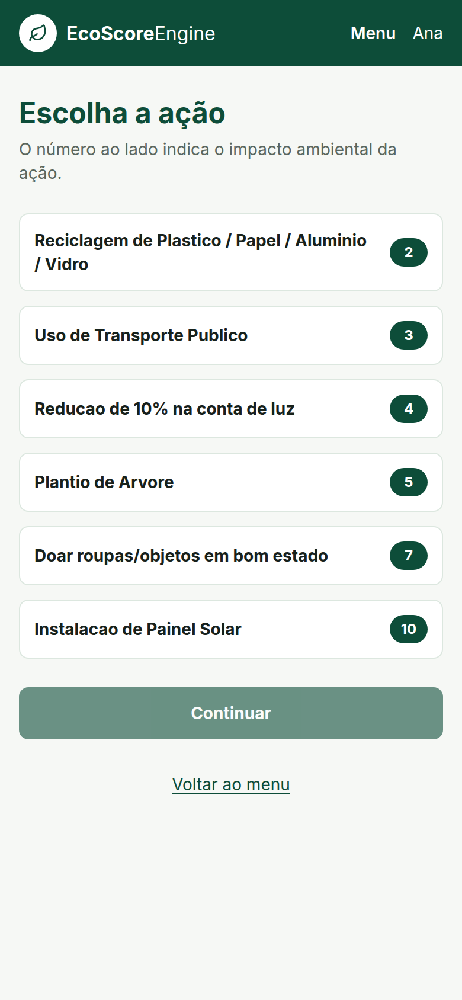
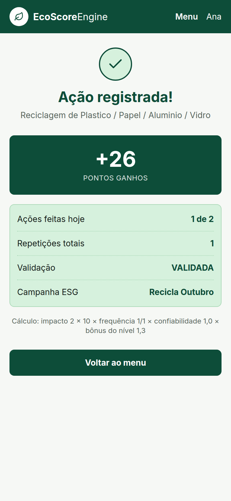
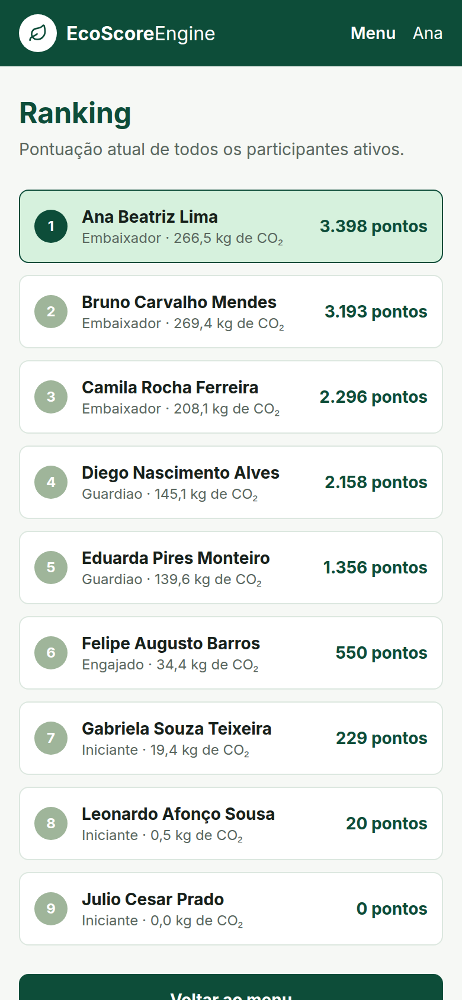
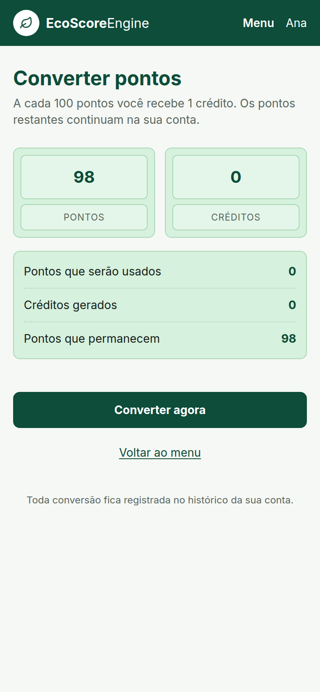
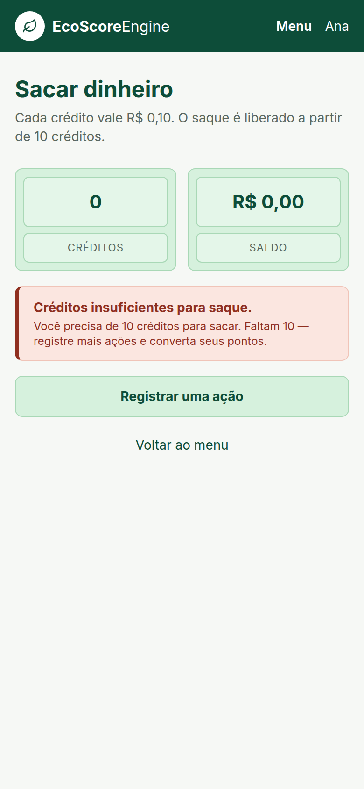
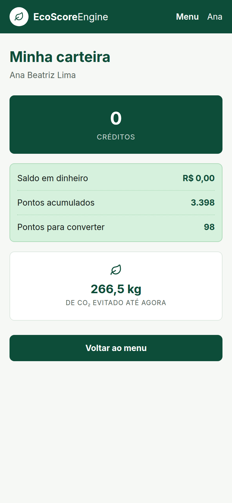

# EcoScore Engine


Plataforma de incentivo a ações sustentáveis da **GaiaTech**, desenvolvida para o **Challenge SoulUp / FIAP 2026** (turma 1TDSPV).

**O problema:** quem recicla, usa transporte público ou economiza energia não recebe nada em troca, e as empresas que investem em ESG não conseguem medir o impacto real das suas campanhas.

**A solução:** o participante registra cada ação sustentável e ganha pontos (impacto × 10 × frequência × confiabilidade × bônus do nível). A cada 3 ações ele conclui uma missão e sobe de nível. 100 pontos viram 1 crédito e 10 créditos viram R$ 1,00 de saque via PIX. Empresas patrocinam campanhas ESG e acompanham os números agregados.

Este repositório é o **Front-end da Sprint 4**: uma SPA em React que consome a **API Java publicada no Render**, com as telas do protótipo da documentação de Java, a landing page e as páginas institucionais.

---

## Tecnologias

- [React 19](https://react.dev/) com [Vite](https://vite.dev/) e [TypeScript](https://www.typescriptlang.org/)
- [Tailwind CSS 4](https://tailwindcss.com/) (via `@tailwindcss/vite`), responsivo com `sm:`, `md:`, `lg:` e `xl:`
- [React Router 7](https://reactrouter.com/) (rotas estáticas, dinâmicas, protegidas, `lazy()` e 404)
- [React Hook Form](https://react-hook-form.com/) nos formulários
- **Fetch API** (sem Axios) numa camada de services tipada
- [ViaCEP](https://viacep.com.br/) (API pública) para preencher o endereço no cadastro
- [lucide-react](https://lucide.dev/) (ícones) e [react-error-boundary](https://github.com/bvaughn/react-error-boundary)
- API Java (Spring Boot + Oracle) publicada no **Render**
- Deploy na **Vercel**

---

## Estrutura de pastas

```
src/
├── main.tsx            StrictMode + BrowserRouter + AuthProvider
├── App.tsx             rotas com lazy(), RotaProtegida e path="*" → NotFoundPage
├── index.css           @theme (cores e fontes) + @layer base + @layer components (.card, .btn-primary, .field)
├── types/              api.ts (interfaces dos DTOs, union e intersection types) · member.ts
├── services/           api.ts (fetch, VITE_API_URL, ApiError, header X-Usuario-Id) e um service por recurso
├── contexts/           AuthContext.tsx (sessão do participante com useContext)
├── hooks/              useAuth, useDocumentTitle e um hook por recurso (useAcoes, usePainel, useRanking...)
├── utils/              formatadores.ts (Intl) · validacoes.ts (CPF, telefone, CEP, idade)
├── layouts/            MainLayout.tsx (Header + ErrorBoundary + Suspense + Outlet)
├── components/         componentes reutilizáveis (TituloTela, MenuOpcao, ResumoLinhas, MensagemErro, skeletons...)
├── data/               members.ts (integrantes da equipe)
└── pages/              uma página por rota (XxxPage.tsx)
public/                 favicon.svg · img/ (fotos e hero) · docs/prints/ (prints deste README)
```

---

## Integração com a API

| Item | Valor |
|---|---|
| URL base | `https://ecoscoreengine-api.onrender.com` (variável `VITE_API_URL`) |
| Identificação | `POST /auth/login` devolve o usuário; as rotas protegidas recebem o header `X-Usuario-Id` |
| Erros | `{"erro": "...", "detalhe": "..."}`, tratados em `services/api.ts` com mensagens em português |

> No plano gratuito do Render a API "dorme": o primeiro acesso pode levar até 1 minuto.

| Página (rota) | Endpoint | Verbo |
|---|---|---|
| Login (`/login`) | `/auth/login` | POST |
| Cadastro (`/cadastro`) | `/auth/cadastro` + ViaCEP `https://viacep.com.br/ws/{cep}/json/` | POST / GET |
| Menu (`/menu`) | `/usuarios/{id}` | GET |
| Escolher ação (`/registrar`) | `/acoes` | GET |
| Confirmar registro (`/registrar/:acaoId`) | `/acoes/{id}` e `/registros` | GET / POST |
| Ação registrada (`/registrar/:acaoId/registrada`) | resposta do POST `/registros` | — |
| Ranking (`/ranking`) | `/ranking` | GET |
| Converter (`/converter`) | `/usuarios/{id}/painel` e `/usuarios/{id}/conversoes` | GET / POST |
| Sacar (`/sacar`) | `/usuarios/{id}/painel` e `/usuarios/{id}/saques` | GET / POST |
| Minha carteira (`/carteira`) | `/usuarios/{id}/painel` | GET |

**Usuários de teste** (senha `Eco@2026`): `ana.lima@email.com` e `bruno.mendes@email.com`.

---

## Autores e Créditos

<table>
  <tr>
    <td align="center">
      <br/>
      <strong>Leonardo Afonço Sousa</strong><br/>
      RM573982 — 1TDSPV<br/>
      <a href="https://github.com/Leonardo-2112">GitHub</a> ·
      <a href="https://www.linkedin.com/in/leonardoafoncosousa/">LinkedIn</a>
    </td>
    <td align="center">
      <br/>
      <strong>Matheus Jones Sousa de Freitas</strong><br/>
      RM573559 — 1TDSPV<br/>
      <a href="https://github.com/Matheus-Jones">GitHub</a> ·
      <a href="https://www.linkedin.com/in/matheus-jones10/">LinkedIn</a>
    </td>
    <td align="center">
      <br/>
      <strong>Syang Cristina Gomes Souza</strong><br/>
      RM569259 — 1TDSPV<br/>
      <a href="https://github.com/SyangSouzaa">GitHub</a> ·
      <a href="https://www.linkedin.com/in/syang-souza/">LinkedIn</a>
    </td>
  </tr>
  <tr>
    <td align="center">
      <br/>
      <strong>Joao Machado Nascimento</strong><br/>
      RM572364 — 1TDSPV<br/>
      <a href="https://github.com/MachadoJN">GitHub</a> ·
      <a href="https://www.linkedin.com/in/jo%C3%A3o-machado-493178300">LinkedIn</a>
    </td>
    <td align="center">
      <br/>
      <strong>Vitor Gonçalves de Souza</strong><br/>
      RM569023 — 1TDSPV<br/>
      <a href="https://github.com/v1torceleste">GitHub</a> ·
      <a href="https://www.linkedin.com/in/vitor-souza-39aa422b4/">LinkedIn</a>
    </td>
    <td></td>
  </tr>
</table>

---

## Imagens e Ícones

Os ícones são do [lucide-react](https://lucide.dev/) e seguem o protótipo (folha no logo, `Plus`, `BarChart3`, `ArrowLeftRight`, `Banknote`, `Wallet`, `LogOut`, `Check`). A imagem do hero fica em `public/img/hero-ecoscore.svg`.

| Landing page | Login | Menu do participante |
|---|---|---|
|  |  |  |

| Escolher ação | Ação registrada | Ranking |
|---|---|---|
|  |  |  |

| Converter pontos | Sacar dinheiro | Minha carteira |
|---|---|---|
|  |  |  |

---

## Como Usar

| Link | Endereço |
|---|---|
| Repositório GitHub | `https://github.com/Leonardo-2112/EcoScoreEngine` |
| Vídeo no YouTube | `` |
| Aplicação na Vercel | `https://ecoscoreengine.vercel.app` |
| API publicada (Render) | `https://ecoscoreengine-api.onrender.com` |

**Rodando localmente** (Node.js 20 ou superior):

```bash
git clone https://github.com/Leonardo-2112/EcoScoreEngine.git
cd EcoScoreEngine
npm install
cp .env.example .env    # no Windows: copy .env.example .env
npm run dev
```

A aplicação abre em `http://localhost:5173`. Para gerar a versão de produção: `npm run build`.

Fluxo para testar: landing → **Cadastrar-se** (o CEP preenche o endereço) → **Entrar** → menu → registrar ação → ranking → converter → sacar → carteira.

---

## Contato

Dúvidas ou sugestões sobre o projeto: **ecoscore@fiap.com.br**

GitHub dos integrantes: [Leonardo-2112](https://github.com/Leonardo-2112) · [Matheus-Jones](https://github.com/Matheus-Jones) · [SyangSouzaa](https://github.com/SyangSouzaa) · [MachadoJN](https://github.com/MachadoJN) · [v1torceleste](https://github.com/v1torceleste)

Projeto acadêmico — Turma **1TDSPV**, FIAP, Challenge SoulUp 2026.
